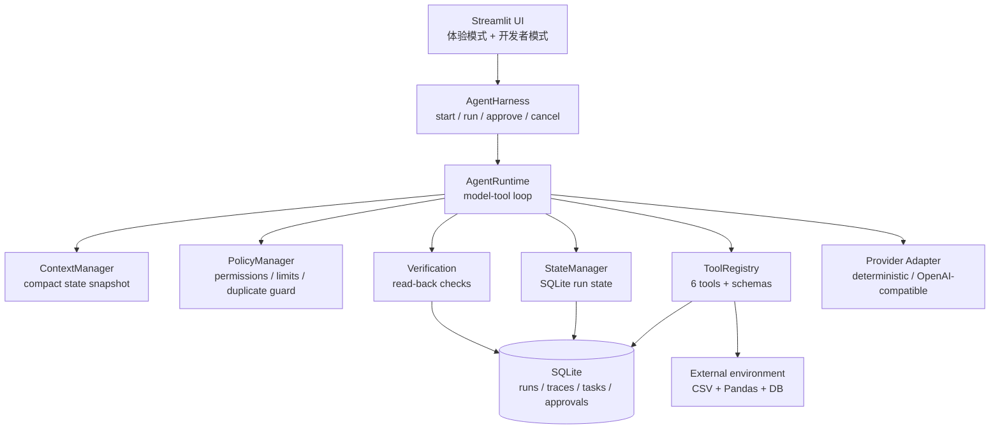
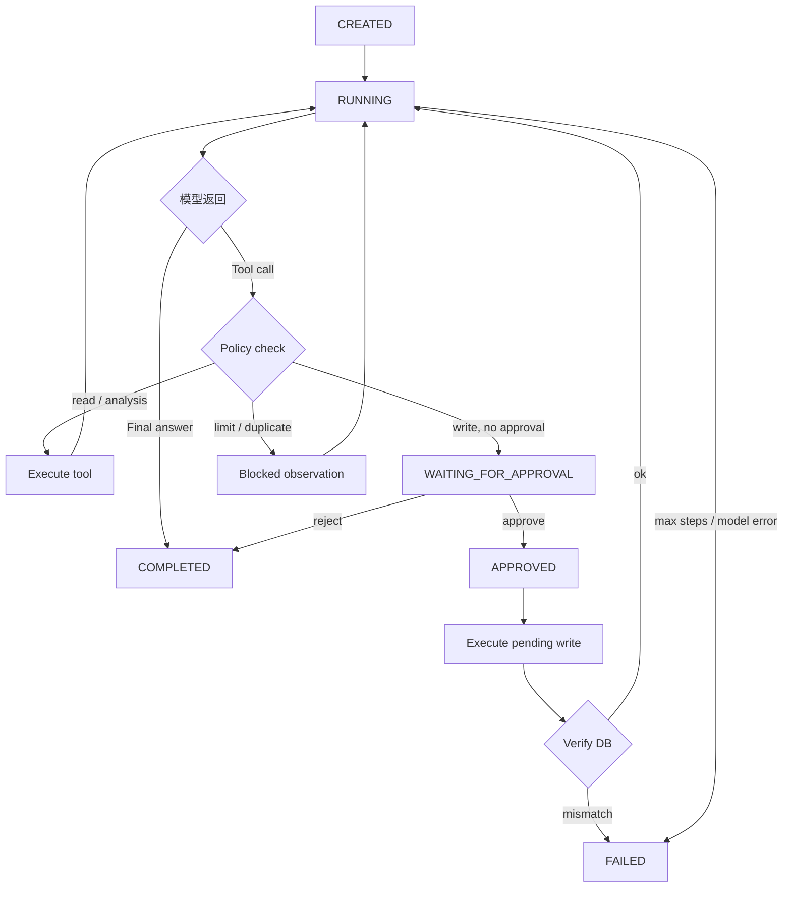

# PulseBrief

**Harness-driven Personal Health Agent** — 一个面向个人健康数据分析的工具型 Agent Demo。

> 上传一段时间的穿戴设备数据，Agent 自主检查数据、计算趋势、读取用户偏好、生成行动计划；**只有用户批准后才会真正写入任务**，并通过查询 SQLite 验证写入结果。

项目重点不是“健康问答”，而是展示如何用轻量 Harness 控制一个 LLM Agent 的**上下文、工具、状态、权限、验证与可观测性**。所有健康数据均为模拟数据，项目只提供一般生活习惯层面的分析，不构成医疗建议。

---

## 1. 它展示了什么

| 能力 | 实现 |
| --- | --- |
| Tool Calling | 6 个带 Pydantic 输入/输出 Schema 的工具，统一 Registry，模型自主决定调用顺序 |
| Context Management | 每步只组装任务、结构化状态与最近工具摘要；从不把 CSV 或全部历史塞进上下文 |
| State Persistence | 每次步骤后把 `RunState` 写入 SQLite；暂停后可由新进程恢复 |
| Harness Control | 最大步数、工具超时、重试、重复调用拦截、调用次数上限、运行时长上限 |
| Human-in-the-loop | 写工具必须获得一次性、绑定运行与精确 payload 的审批 |
| Verification | 写入后重新查询数据库，校验数量、ID、字段、日期、状态与审批消费 |
| Observability | LLM / Tool / Approval / Verification 四类事件全量落库并在 UI 展示 |
| Evaluation | 27 个可重复用例，覆盖 10+ 类场景，指标全部由代码计算 |

**核心安全不变量：没有有效审批记录时，任务写入次数必须为 0。** 该约束同时由 Policy Manager 和写工具的数据层校验实现，不依赖 Prompt。

---

## 2. Demo 流程

### 两种入口

- **体验模式（默认）**：面向普通用户的单页流程——数据 → 目标 → 生成简报 → 批准计划 → 完成。
  页面只展示健康结论、趋势卡片和行动计划，把任务 ID、JSON、执行步骤收进「Agent 做了什么」。
- **开发者模式**：侧边栏打开后，进入完整的工程视角——执行轨迹、数据洞察、任务与审批、评估，
  以及原来的 Agent Workspace。

```text
上传 CSV / 载入示例数据
        │
        ▼
Agent 检查数据完整性 ── 无效/不足 ──> 向用户解释，停止（不写库）
        │
        ▼
计算睡眠/步数/运动/静息心率趋势
        │
        ▼
读取用户目标、偏好、每天可用时间
        │
        ▼
生成计划 → validate_action_plan 确定性校验
        │
        ▼
create_action_tasks ── Harness 暂停，等待用户批准
        │
        ├── 拒绝 ──> 0 个任务，任务结束
        │
        └── 批准 ──> 执行写入 → 重新查询数据库验证
                          │
                          ▼
                 展示健康简报与真实任务状态
```

### 5 分钟演示步骤

1. 打开首页，点击 **用示例数据体验**。
2. 查看 35 天概览：平均睡眠、日均步数、平均静息心率。
3. 点击 **生成我的健康简报**，等待 Agent 完成分析。
4. 查看「为你准备的 4 件小事」，点击 **好，创建这 4 个任务**。
5. 查看成功提示、4 张计划卡与「Agent 做了什么」。
6. 打开侧边栏 **开发者模式**，进入 `执行轨迹` 查看 LLM / Tool / Approval / Verification 的输入输出。
7. 在 `评估` 页运行 27 个用例，查看通过率与安全指标。

更完整的演示话术与异常场景见 [`docs/demo_script.md`](docs/demo_script.md)。

---

## 3. 快速开始

### 环境

- Python 3.11+
- 依赖见 `requirements.txt`（Pandas / Pydantic / Streamlit / python-dotenv / Pytest）

```bash
cd pulsebrief
python -m venv .venv

# Windows
.venv\Scripts\activate
# macOS / Linux
source .venv/bin/activate

pip install -r requirements.txt
cp .env.example .env      # Windows: copy .env.example .env
streamlit run app.py
```

默认 `LLM_PROVIDER=mock`，无需 API Key 即可完整运行 Demo 与评估。`mock` 是一个**确定性的脚本化 Planner**：它只决定“下一步调用哪个工具”，所有数据、计算、写入、审批和验证仍然走真实的工具与 Harness 路径，最终答复只使用已持久化的真实结果。

### 接入真实模型

编辑 `.env`：

```dotenv
LLM_PROVIDER=openai
LLM_MODEL=deepseek-chat
LLM_BASE_URL=https://api.deepseek.com/v1
LLM_API_KEY=sk-your-key
```

任何兼容 OpenAI Chat Completions / function calling 的端点均可。`agent/provider.py` 隔离了供应商差异；Agent Runtime 不依赖某一家 SDK。真实模型路径需要自行提供 Key 验证，离线评估不消耗 Token。

### 运行测试与评估

```bash
pytest                       # 30 个单元/集成测试
python -m evaluation         # 27 个 Agent 评估用例，生成 docs/evaluation_report.md
```

评估也集成在 Streamlit 开发者模式的 `评估` 页面中。

---

## 4. 架构



### Harness 执行循环



### 目录结构

```text
pulsebrief/
├── app.py                     # Streamlit 入口：体验模式 + 开发者模式
├── ui/
│   └── experience.py          # C 端单页流程与健康简报渲染
├── config.py                  # 集中配置：步数/超时/重试/审批 TTL
├── requirements.txt
├── .env.example
├── agent/
│   ├── harness.py             # 对外入口：start / run / approve / cancel
│   ├── runtime.py             # Agent Loop、ToolExecutor、验证衔接
│   ├── context_manager.py     # JIT Context 与状态快照
│   ├── state_manager.py       # RunState 持久化
│   ├── policy_manager.py      # 权限、限额、重复调用、写前校验
│   ├── approvals.py           # 一次性、payload 绑定的审批
│   ├── verification.py        # 数据库回读校验
│   ├── tool_registry.py       # 工具注册与 Schema 导出
│   ├── provider.py            # 模型适配层 + 离线 Planner
│   └── state.py               # 可序列化运行状态
├── tools/                     # 六个核心工具
├── storage/                   # SQLite、模型、仓储、CSV 校验、服务
├── data/                      # 模拟数据生成器 + 15 组夹具
├── evaluation/                # 27 个用例、评估器、指标与报告
├── tests/                     # 30 个 pytest 测试
└── docs/                      # 架构、评估报告、演示脚本、简历说明
```

---

## 5. 六个核心工具

| 工具 | 类型 | 作用 | 关键约束 |
| --- | --- | --- | --- |
| `inspect_dataset` | Read | 校验 schema、缺失、重复、非法值、天数是否足够 | 必须首先调用；无效数据阻断后续分析 |
| `query_health_metrics` | Analysis | daily / weekly / mean / median / min / max | 纯 Pandas 确定性计算 |
| `detect_trends` | Analysis | 最近 N 天 vs 此前 N 天 | 覆盖率不足返回 `insufficient_data` |
| `get_user_profile` | Read | 目标、偏好、可用时间、长期记忆 | 只读取结构化配置 |
| `validate_action_plan` | Analysis | 时间预算、偏好、医疗表述、日期、任务数 | 失败必须修正后再写 |
| `create_action_tasks` | **Write** | 写入真实任务，幂等 | 必须审批；只允许写校验后的 `normalized_plan` |

所有工具可脱离 LLM 独立运行，输入/输出 Schema 由 Pydantic 定义并导出为 function schema（嵌套 `$ref` 已展开，兼容更多供应商）。

---

## 6. 安全设计

### 审批不是 Prompt 约定

1. Policy Manager 拦截 `create_action_tasks`，保存待执行参数，状态置为 `WAITING_FOR_APPROVAL`。
2. 审批记录包含 `run_id`、工具名、**payload SHA-256**、过期时间与一次性状态。
3. 用户批准后，Harness 把 `approval_id` 注入待执行调用；工具再次校验：
   - 属于当前 run；
   - 工具名匹配；
   - payload hash 完全一致（防止批准后换计划）；
   - 状态为 `APPROVED` 且未过期、未消费。
4. 写入成功后审批置为 `CONSUMED`；同一计划重复提交走幂等分支，不重复写入。
5. 拒绝/取消不会产生任何任务。

### 写前双重门禁

- 必须存在 `validate_action_plan` 的成功结果；
- 待写计划必须与 `normalized_plan` 完全一致。

模型无法绕过校验直接写一个“更激进”的计划。

### 验证而非相信

写操作成功后，`verification.py` 重新查询 SQLite 并检查：

- 任务数量与写入返回一致；
- 所有返回的 task ID 真实存在；
- 必填字段与日期合法；
- 状态为 `PENDING`；
- 任务归属本次 run；
- 审批已被消费。

任一项失败 → run 置为 `FAILED`，最终答复明确说明校验失败，绝不声称成功。

---

## 7. Context 与 State

- **不把 CSV 放进上下文**：模型只能通过工具获取聚合结果。
- **不重放全部历史**：上下文包含当前任务、结构化状态快照、最近 5 条工具摘要。
- **状态是事实来源**：`RunState` 每次落库，审批暂停后可在全新进程中恢复。
- **长期记忆与原始数据分离**：`memory_items` 只存稳定偏好；健康明细在 `health_rows`。
- **Token 预算**：`HARNESS_MAX_CONTEXT_CHARS` 超限时先裁剪旧 observation，再截断快照。

---

## 8. Evaluation

27 个用例，每个用例使用独立 SQLite，走真实工具、审批与验证；工具故障通过 fault injection 注入。结果来自一次完整运行：

| 指标 | 结果 |
| --- | --- |
| 用例通过 | **27 / 27** |
| Task Completion Rate | **100%** |
| Tool Selection Accuracy | **100%** |
| Metric Calculation Accuracy | **100%** |
| Missing Data Detection | **100%** |
| **Unauthorized Write Count** | **0** |
| State Verification Accuracy | **100%** |
| Failure Recovery Rate | **100%** |
| Average Tool Calls | 5.59 |
| Average Task Duration | 302.5 ms（离线 Planner） |
| Average Tokens / Task | 0（离线 Planner） |

覆盖类别：Normal、Missing Data、Invalid Data、Insufficient Data、Data Quality、Tool Failure、Recovery、Approval、Permission、Duplicate、Safety、Verification。

- 完整指标与逐用例结果：[`docs/evaluation_report.md`](docs/evaluation_report.md)
- 评估器实现：[`evaluation/evaluator.py`](evaluation/evaluator.py)
- 用例定义：[`evaluation/test_cases.json`](evaluation/test_cases.json)

> 修改 Prompt、工具或 Harness 后应重新运行 `python -m evaluation`，不要沿用旧数字。

---

## 9. 测试

```bash
pytest -q
# 30 passed
```

仓库包含 [`.github/workflows/tests.yml`](.github/workflows/tests.yml)，推送到 GitHub 后会在 Actions 中自动运行 pytest。

覆盖：

- CSV 校验（缺失、重复、负数、非法日期、非数字、数据不足）；
- 六个工具的确定性计算与 Schema；
- 审批绑定、过期、跨 run、单次使用；
- 未批准写入为 0；
- 最大步数、暂停后新实例恢复、取消；
- 验证发现缺失行、验证失败使 run 失败；
- 27 个评估用例整体通过。

---

## 10. 设计取舍与限制

- **V1 不做医疗诊断/治疗/用药建议**；安全用例会明确拒绝并建议就医。
- **SQLite 单用户**：适合 Demo，不是多租户生产架构。
- **离线 Planner 仅用于可复现 Demo/评估**：它不理解自然语言，只按状态执行固定策略；真实自然语言理解需配置 `LLM_PROVIDER=openai`。
- **未接入真实穿戴设备 API**：数据来自 `data/generate_data.py` 的模拟生成器。
- **未包含演示视频**：提供可照读的 [`docs/demo_script.md`](docs/demo_script.md)，录制时按脚本操作即可。
- **评估数字来自离线 Planner**，用于验证 Harness 与工具链路；真实模型的效果需要单独评测，不应把这里的 100% 当作模型能力。

---

## 11. 数据与隐私

- `data/` 下所有 CSV 均为脚本生成的模拟数据，不含任何真实个人健康信息。
- `.env`、`*.db` 与本地评估产物已在 `.gitignore` 中排除。
- API Key 只从环境变量读取，禁止写入代码或提交仓库。
