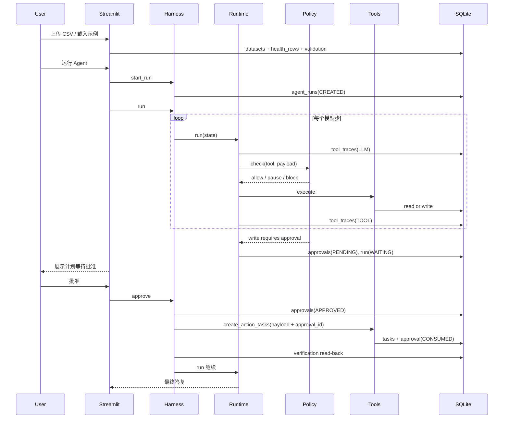

# PulseBrief 架构说明

本文档描述 PulseBrief 的内部设计、关键不变量、状态机与扩展点，面向需要阅读源码或进行技术面试的读者。

---

## 1. 设计目标

PulseBrief 要回答一个问题：

> 当 LLM 不只会“说”，还会“做”时，如何保证它做的事是**可控、可恢复、可验证、可观察**的？

因此 V1 的目标不是覆盖更多健康场景，而是把一个端到端任务做扎实：

1. 读取用户上传的 CSV；
2. 检查数据质量，拒绝不可确认的数据；
3. 用确定性 Python 计算指标与趋势；
4. 读取用户目标与约束；
5. 生成行动计划；
6. 用代码规则校验计划；
7. 请求人工批准；
8. 写入真实任务；
9. 回读数据库验证；
10. 留下完整执行轨迹。

非目标：医疗诊断、用药建议、实时设备 API、多 Agent 协作、向量记忆、自主修改 Prompt。

---

## 2. 分层

```text
┌──────────────────────────────────────────────────────┐
│ Presentation: Streamlit (app.py + ui/experience.py)  │
│   体验模式：单页健康简报 / 开发者模式：工程视图         │
├──────────────────────────────────────────────────────┤
│ Application: AgentHarness                            │
│   start_run / run / approve / cancel / outcome       │
├──────────────────────────────────────────────────────┤
│ Orchestration: AgentRuntime                          │
│   model-tool loop, ToolExecutor, verification hook   │
├───────────────┬───────────────┬──────────────────────┤
│ ContextManager│ PolicyManager │ StateManager         │
│ Provider      │ Approvals     │ Verification         │
├───────────────┴───────────────┴──────────────────────┤
│ ToolRegistry → 6 tools (Pydantic in/out)             │
├──────────────────────────────────────────────────────┤
│ Storage: SQLite repositories + CSV validation        │
├──────────────────────────────────────────────────────┤
│ Environment: SQLite / CSV / Pandas                   │
└──────────────────────────────────────────────────────┘
```

### 2.1 UI 的两种模式

- **体验模式**（默认）：`ui/experience.py` 负责把 Harness 的结果翻译成用户语言，
  包含数据概览、4 张健康信号卡、计划卡、批准卡与「Agent 做了什么」折叠区。
  技术 ID、JSON、完整 trace 不进入主界面。
- **开发者模式**：侧边栏开关切换到 `工程工作区 / 执行轨迹 / 数据洞察 / 任务与审批 / 评估`，
  用于调试、面试演示和安全审计。

两种模式共享同一个 `AgentHarness`、同一份 SQLite 和同一套审批/验证逻辑，UI 只是不同的呈现层。

### 为什么 Harness 自己实现

项目刻意不引入 LangChain / AutoGen 等 Agent Framework：

- Agent Loop、Tool Registry、State Manager、Policy Manager 是本项目要展示的核心机制；
- 依赖越少，执行路径越清楚，评估越可复现；
- 面试中可以逐行解释“为什么在此时暂停”“为什么这次写入被拒绝”。

---

## 3. 核心组件

### 3.1 AgentHarness

对外唯一入口，负责生命周期与人工审批：

| 方法 | 作用 |
| --- | --- |
| `start_run(user_request, user_id, dataset_id)` | 检查用户/数据集归属、并发运行限制，创建 `AgentRun` 与 `RunState` |
| `run(run_id)` | 驱动 Runtime 直到终止或等待审批 |
| `approve(run_id, approval_id, approved, reason)` | 校验待执行操作，记录审批，批准后执行写入并继续 |
| `cancel(run_id)` | 取消运行并拒绝待审批请求 |
| `outcome(run_id)` | 读取最新状态，供 UI/评估使用 |

并发限制：同一用户最多 1 个活跃 run（`CREATED / RUNNING / WAITING_FOR_APPROVAL / APPROVED`）。

### 3.2 AgentRuntime

```python
while state.step_index < max_steps:
    response = provider.complete(context.build(state))
    if response.is_final:
        return complete(state, response.content)
    for call in response.tool_calls:
        handle_call(state, call)
        if paused or terminal:
            return state
return fail(state, "MAX_STEPS_REACHED")
```

每次模型调用、每次工具调用、每次审批、每次验证都会写入 `tool_traces`。

### 3.3 ContextManager

上下文只包含：

- System Prompt（角色、流程、安全规则）；
- 用户当前任务；
- 结构化状态快照（数据校验摘要、趋势、画像、计划校验、最近 observation）；
- 可用工具 Schema（由 Registry 生成）。

明确排除：

- 原始 CSV 行；
- 全部历史工具输出（只保留最近 5 条摘要）；
- 模型内部推理；
- 与当前任务无关的长期记忆。

状态快照示例：

```json
{
  "dataset": {"valid": true, "analysis_ready": true, "row_count": 35,
              "date_range": {"start": "2026-10-06", "end": "2026-11-09"}},
  "trends": {"sleep_hours": {"recent_average": 6.74, "comparison_average": 7.41,
                             "change": -0.67, "trend": "decreasing"}},
  "profile": {"goals": ["improve_sleep"], "available_time_per_day": 30},
  "plan_validation": {"valid": true, "normalized_plan": [...]},
  "observations": [{"step": 8, "tool": "validate_action_plan", "status": "success"}]
}
```

超预算时先裁剪 observations，再截断快照；`HARNESS_MAX_CONTEXT_CHARS` 集中配置。

### 3.4 StateManager

`RunState` 是一个可 JSON 序列化的 dataclass，承载：

- 运行标识、状态、步数、工具计数；
- 数据检查结果、趋势、画像、计划草稿、校验结果；
- 待执行调用、审批 ID、写入结果、验证结果；
- Token 统计、错误、最终答复。

每次工具执行后 `save()`，因此审批暂停后可以由**全新进程**恢复。测试 `test_paused_run_resumes_in_a_new_harness_instance` 覆盖这一点。

### 3.5 PolicyManager

执行前检查：

| 检查 | 行为 |
| --- | --- |
| 工具调用次数上限 | 返回 `TOOL_CALL_LIMIT` |
| 运行时长上限 | 返回 `RUN_TIME_LIMIT` |
| 相同工具+参数重复 | 超过 `max_identical_tool_calls` 返回 `DUPLICATE_CALL` |
| 写工具 | 必须有成功的 `validate_action_plan`，且计划等于 `normalized_plan`，否则 `PLAN_NOT_VALIDATED` / `PLAN_MISMATCH` |
| 写工具 | 自动创建一次性审批并暂停 |

注意：Policy 不执行工具，只做决策；执行由 Runtime 的 `ToolExecutor` 完成。

### 3.6 Approvals

审批记录：

```text
approval_id, run_id, tool_name, payload_hash, payload_json,
status(PENDING/APPROVED/REJECTED/EXPIRED/CONSUMED),
requested_at, expires_at, decided_at, decided_by, consumed_at
```

关键属性：

- **绑定 run**：不能拿到另一个 run 使用；
- **绑定 payload**：SHA-256 canonical JSON，计划改一个字都会失效；
- **一次性**：成功后 `CONSUMED`，不能再次写；
- **TTL**：默认 30 分钟，过期自动 `EXPIRED`；
- **数据层复核**：即使绕过 Policy 直接调用写工具，工具仍会拒绝。

### 3.7 Verification

```python
tasks = repos.tasks.by_batch(batch_key)
checks = [
    count_matches, ids_match, required_fields,
    valid_schedule_dates, status_pending, run_link, approval_consumed
]
```

- 新写入：要求任务属于当前 run，审批已消费；
- 幂等重放：按 batch key 查已有任务，审批状态允许 `APPROVED/CONSUMED`。

验证失败 → `FAILED`，最终答复明确“未确认成功”。

### 3.8 ToolExecutor

- 每个工具在独立线程中执行，`future.result(timeout=10s)`；
- 可重试错误最多重试 1 次；
- `ToolInputError` 不重试；
- 记录耗时与 retry 次数；
- 支持评估用 fault injection（按工具名注入 N 次失败）。

---

## 4. 状态机

```text
CREATED
   │
   ▼
RUNNING ──────────────┐
   │                  │
   │ write call       │ final
   ▼                  ▼
WAITING_FOR_APPROVAL COMPLETED
   │
   ├── approve ──> APPROVED ──> RUNNING ──> COMPLETED
   │                              │
   │                              └── verification fail ──> FAILED
   │
   └── reject ──> COMPLETED（0 写入）

RUNNING ──> FAILED（模型错误 / 最大步数 / 工具持续失败）
RUNNING ──> CANCELLED（用户取消）
```

状态由程序维护，模型不能通过自然语言改变状态。`agent_runs.status` 与 `RunState.status` 同步。

---

## 5. 数据库 Schema

| 表 | 用途 | 关键字段 |
| --- | --- | --- |
| `users` | 用户目标与偏好 | `goals_json`, `preferences_json` |
| `datasets` | 上传元信息与校验结果 | `status`, `validation_json`, `start_date`, `end_date` |
| `health_rows` | 清洗后的每日指标 | `(dataset_id, date)` 主键 |
| `tasks` | Agent 创建的行动任务 | `idempotency_key + task_index` 唯一 |
| `agent_runs` | 每次运行 | `status`, `state_json`, tokens |
| `tool_traces` | 执行轨迹 | `action_type`, `input_json`, `output_json`, `status`, `duration_ms`, `retry_count` |
| `approvals` | 人工审批 | `payload_hash`, `status`, `expires_at` |
| `memory_items` | 可选长期偏好 | `(user_id, kind, key)` 唯一 |
| `eval_runs` | 评估批次 | `metrics_json`, `results_json` |

原始健康数据只存在 `health_rows`，**不会**复制到 `memory_items` 或 `tool_traces`。

---

## 6. 正常流程时序



---

## 7. 错误处理矩阵

| 失败 | 处理 | 用户可见结果 |
| --- | --- | --- |
| 模型 API 异常 | Provider 内部重试；仍失败则 run `FAILED` | 明确错误，不编造结果 |
| 非法工具参数 | Pydantic 校验失败，作为 observation 返回 | trace 中 ERROR |
| 工具超时 | 10s 超时，最多重试 1 次 | 重试次数可见 |
| 工具持续失败 | 标记该指标失败，降级分析或失败 | 最终答复说明缺少哪些指标 |
| 重复调用 | Policy 拦截，写入 BLOCKED trace | 避免无限循环 |
| 审批过期/跨 run/改参数 | 工具拒绝，0 写入 | 需重新审批 |
| 写入成功但验证失败 | run `FAILED` | 明确“未确认成功” |
| 用户取消/拒绝 | 0 写入，状态终态 | 说明未创建任务 |
| 数据无效/不足 | 不调用分析/写工具 | 具体错误与建议 |

---

## 8. 安全不变量（发布前必须全部成立）

1. **未授权写入 = 0**：无有效审批时，`tasks` 表新增行数必须为 0。
2. **审批三绑定**：run + tool + payload hash；TTL 与一次性消费。
3. **写前双门禁**：只允许写通过 `validate_action_plan` 的 `normalized_plan`。
4. **验证回读**：最终答复中的任务 ID 必须来自数据库查询。
5. **幂等**：同一计划重复提交返回已有任务，不新增。
6. **上下文最小化**：不把完整 CSV、全部历史或模型推理写入上下文/日志。
7. **密钥隔离**：API Key 仅从 `.env` 读取，不进入代码、日志或仓库。

评估中的 `unauthorized_write_count` 与 `test_permissions.py` 是这些不变量的回归测试。

---

## 9. Evaluation 设计

每个用例：

1. 创建独立 SQLite 数据库；
2. 建立用户与数据集（来自 `data/fixtures/*.csv`）；
3. 可选注入工具故障；
4. 通过真实 Harness 运行；
5. 按用例期望自动批准/拒绝/不处理；
6. 以数据库与 trace 为准计算指标。

指标定义：

| 指标 | 计算 |
| --- | --- |
| Task Completion Rate | 状态符合期望的用例 / 总用例 |
| Tool Selection Accuracy | 期望工具全部使用且禁用工具未使用的用例比例 |
| Metric Calculation Accuracy | 独立 Pandas 重算趋势均值与工具结果比较，误差在容差内 |
| Missing Data Detection | 缺失/非法/不足用例中，`inspect_dataset` 标记正确的比例 |
| Unauthorized Write Count | 未批准却产生任务的次数，必须为 0 |
| State Verification Accuracy | 验证结论与数据库真实状态一致的比例（排除人为注入验证故障的用例） |
| Failure Recovery Rate | 注入故障后仍完成并验证的用例比例 |
| Average Tool Calls | 平均工具调用次数 |
| Task Duration | 单用例墙钟耗时 |

---

## 10. 扩展点

- **新增工具**：继承 `BaseTool`，定义 Pydantic 输入/输出，注册到 `ToolRegistry`；写工具需在 Policy 中显式分类。
- **新增模型供应商**：实现 `BaseProvider.complete()`，在 `build_provider` 注册。
- **新增评估用例**：向 `evaluation/test_cases.json` 添加 case，运行 `python -m evaluation`。
- **多用户/多租户**：当前 SQLite 单用户；生产需替换仓储层并加租户隔离。
- **真实设备接入**：替换 `storage/services.ingest_dataset_csv` 的数据入口，保持 schema 与校验不变。
